# 00. Overall System Flow Diagram
## Product Lifecycle: Component Tracking → Product Receiving → Inventory Management → Product Delivery → Reports

### 1. Architectural Narrative
The core product lifecycle represents a strictly linear physical progression in the manufacturing plant:
1. **Master Data & IAM:** `ADMIN` establishes products, components, physical receive/delivery points, and operator accounts.
2. **Component Tracking:** `COMPONENT_TRACKER` associates 1..N serialized component barcodes (e.g., Compressor `94A600321852`) to the finished good product barcode (e.g., Refrigerator `2440701AK2057`).
3. **Product Receiving:** `RECEIVE_USER` verifies prior component tracking and admits the unit into warehouse stock at a specific Receive Point (e.g., `Refrigerator Receive Point 1`).
4. **Inventory Calculation:** The ledger engine records the event. Current stock is computed dynamically from the append-only ledger (`inventory_transactions`).
5. **Product Delivery:** `DELIVERY_USER` verifies stock availability and delivers the product through a Delivery Point (e.g., `Refrigerator Delivery Point 1`), decrementing warehouse stock.
6. **Reporting & Analytics:** `REPORT_VIEWER` or `ADMIN` monitors stock counts, aging inventory, daily throughput graphs, and full barcode event journeys.
7. **Reversal & Correction:** `ADMIN` reverses incorrect operations with mandatory text justification without deleting any historical log.

---

### 2. Mermaid Flowchart

```mermaid
flowchart TD
    %% Styling Definitions
    classDef userAction fill:#E1F5FE,stroke:#0288D1,stroke-width:2px,color:#01579B;
    classDef validation fill:#FFF8E1,stroke:#FFA000,stroke-width:2px,color:#E65100;
    classDef dbOp fill:#EDE7F6,stroke:#7E57C2,stroke-width:2px,color:#4A148C;
    classDef successTx fill:#E8F5E9,stroke:#388E3C,stroke-width:2px,color:#1B5E20;
    classDef failedTx fill:#FFEBEE,stroke:#D32F2F,stroke-width:2px,color:#B71C1C;

    subgraph AdminLane["Role: ADMIN"]
        A_Setup["User Action: Setup Master Data & Users"]:::userAction
        A_Save["Database Op: Store Master Data & Users"]:::dbOp
        A_Rev["User Action: Admin Reversal Portal"]:::userAction
        A_CompRev["Database Op: Append Compensating Event"]:::dbOp
    end

    subgraph TrackerLane["Role: COMPONENT_TRACKER"]
        T_ScanP["User Action: Scan Product Barcode"]:::userAction
        T_ValP{"System Validation: Is Product Active?"}:::validation
        T_ScanC["User Action: Scan Component Barcode"]:::userAction
        T_ValC{"System Validation: Component 1:1 Exclusivity Check"}:::validation
        T_ErrC["Failed TX: Reject Duplicate Component Barcode (409)"]:::failedTx
        T_Tx["Database Op: MongoDB ACID Tx Append 'COMPONENT_TRACKED'"]:::dbOp
        T_Succ["Success TX: Unit Enters TRACKED State"]:::successTx
    end

    subgraph ReceiveLane["Role: RECEIVE_USER"]
        R_Scan["User Action: Scan Product at Receive Point"]:::userAction
        R_ValTrk{"System Validation: Has Unit Undergone Component Tracking?"}:::validation
        R_ErrTrk["Failed TX: Reject Untracked Unit (422)"]:::failedTx
        R_ValStk{"System Validation: Double Receive Check (Already in Stock?)"}:::validation
        R_ErrStk["Failed TX: Reject Double Receive Scan (409)"]:::failedTx
        R_Tx["Database Op: Append 'RECEIVED' Event to Ledger"]:::dbOp
        R_Succ["Success TX: Unit Enters IN_STOCK Status at Point"]:::successTx
    end

    subgraph DeliveryLane["Role: DELIVERY_USER"]
        D_Scan["User Action: Scan Product at Delivery Point"]:::userAction
        D_ValAvail{"System Validation: Is Product Currently IN_STOCK?"}:::validation
        D_ErrAvail["Failed TX: Reject Delivery of Non-Stock Unit (400)"]:::failedTx
        D_Tx["Database Op: Append 'DELIVERED' Event to Ledger"]:::dbOp
        D_Succ["Success TX: Product Status Becomes DELIVERED"]:::successTx
    end

    subgraph ReportLane["Role: REPORT_VIEWER / ADMIN"]
        REP_Open["User Action: Open Reports & Analytics Portal"]:::userAction
        REP_Calc["Database Op: Dynamic Ledger Aggregation Pipeline"]:::dbOp
        REP_View["Success TX: Render Stock Details, Trends & Barcode History"]:::successTx
        REP_Exp["User Action: Stream CSV / Excel Export"]:::userAction
    end

    %% Connections
    A_Setup --> A_Save
    A_Save -.-> T_ScanP
    T_ScanP --> T_ValP
    T_ValP -- Valid --> T_ScanC
    T_ScanC --> T_ValC
    T_ValC -- "Already in use" --> T_ErrC
    T_ValC -- "Unassigned" --> T_Tx
    T_Tx --> T_Succ

    T_Succ --> R_Scan
    R_Scan --> R_ValTrk
    R_ValTrk -- "Not tracked" --> R_ErrTrk
    R_ValTrk -- "Tracked" --> R_ValStk
    R_ValStk -- "Already received" --> R_ErrStk
    R_ValStk -- "Eligible" --> R_Tx
    R_Tx --> R_Succ

    R_Succ --> D_Scan
    D_Scan --> D_ValAvail
    D_ValAvail -- "Not in stock" --> D_ErrAvail
    D_ValAvail -- "In stock" --> D_Tx
    D_Tx --> D_Succ

    D_Succ -.-> REP_Open
    R_Succ -.-> REP_Open
    REP_Open --> REP_Calc
    REP_Calc --> REP_View
    REP_View --> REP_Exp

    %% Reversals
    A_Rev --> A_CompRev
    A_CompRev -.-> REP_Calc
```

