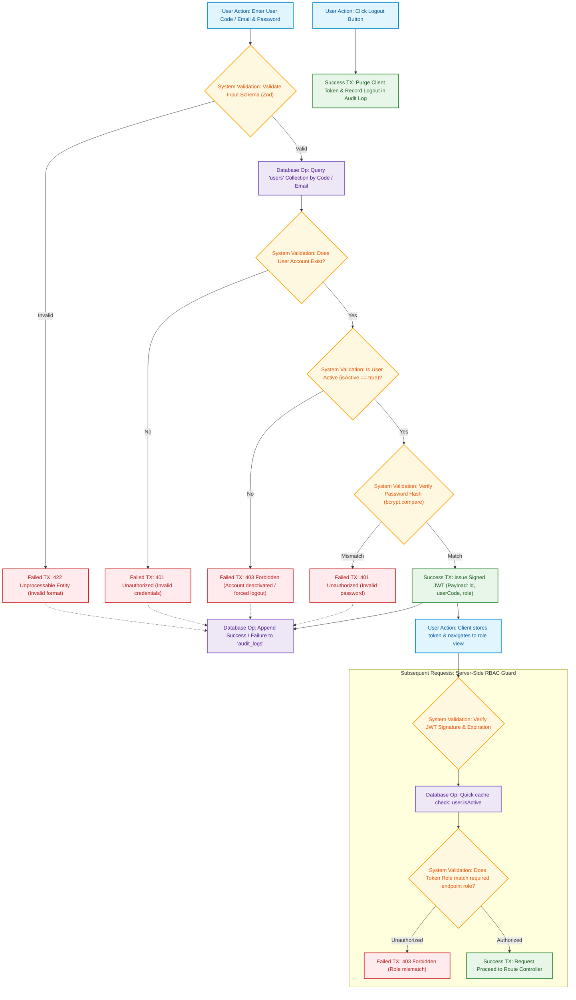

# 01. Authentication & Authorization Flow Diagram
## Roles Involved: All Users (Public, ADMIN, TRACKER, RECEIVE, DELIVERY, REPORT)

### 1. Operational Overview
Authentication enforces zero-trust security:
1. Operator submits credentials (User Code / Email + Password).
2. Input payload validated against strict Zod schema.
3. System fetches user record from MongoDB `users` collection.
4. If user is deactivated (`isActive: false`), the login is rejected and session blocked.
5. Password verified against stored hash using `bcrypt.compare()` (cost factor 12).
6. Upon verification, system generates a signed JWT containing identity and exactly one assigned role.
7. Event is written to `audit_logs` (recording timestamp, user ID, client IP, outcome).
8. Express RBAC middleware validates token on subsequent API requests.
9. Forced logout triggered immediately if an active session belongs to a deactivated user.

---

### 2. Mermaid Flowchart

