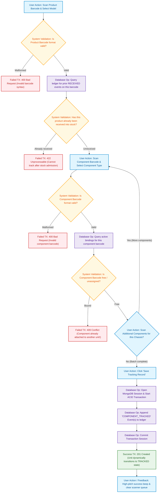

# 02. Component Tracking Flow Diagram
## Responsible Role: `COMPONENT_TRACKER` or `ADMIN`

### 1. Operational Overview
Component tracking binds serialized physical sub-assemblies (e.g., Compressor `94A600321852`) to the finished good product chassis (e.g., Refrigerator `2440701AK2057`):
1. Operator navigates to Component Tracking station.
2. Operator scans/enters the Product Barcode and selects the active Product Model.
3. System verifies product barcode validity and ensures product has not already been received into warehouse stock.
4. Operator scans the serialized Component Barcode and selects the Component Type and Track Point.
5. System executes an exclusivity check against `inventory_transactions`:
   - If the component barcode has an active `COMPONENT_TRACKED` event without a compensating `REVERSED_COMPONENT`, it is rejected with a `409 Conflict`.
6. Operator can scan multiple components (1-to-N relationship).
7. Operator clicks "Save Tracking Record".
8. System executes a MongoDB ACID transaction appending `COMPONENT_TRACKED` event(s) to `inventory_transactions`.
9. High-pitch audio feedback sounds, input fields reset, and product enters `TRACKED` state.

---

### 2. Mermaid Flowchart

