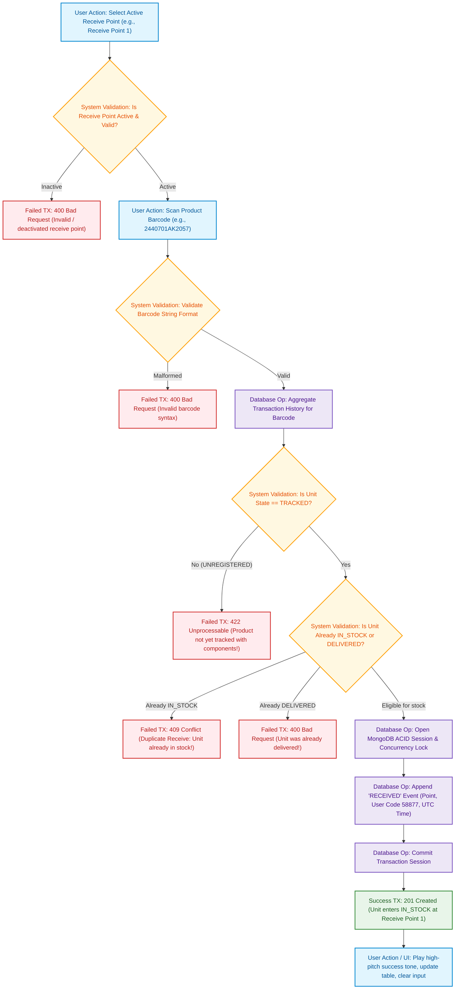

# 03. Product Receiving Flow Diagram
## Responsible Role: `RECEIVE_USER` or `ADMIN`

### 1. Operational Overview
Product receiving admits finished chassis into warehouse stock at designated intake points:
1. Operator navigates to Receiving Station (`/operations/receive`).
2. Operator selects an active Receive Point (e.g., `Refrigerator Receive Point 1`).
3. Operator scans the Product Barcode (e.g., `2440701AK2057`).
4. System executes a dynamic ledger calculation:
   - Verifies unit has a valid prior `COMPONENT_TRACKED` event (Rule BR-04, BR-06). If missing, scan is rejected with `422 Unprocessable Entity`.
   - Verifies unit is not already in stock (`IN_STOCK`) or already delivered (`DELIVERED`) (Rule BR-17). If already in stock, rejected with `409 Conflict` (Duplicate Scan Warning).
5. System opens a MongoDB ACID transaction session with write lock.
6. System appends an immutable `RECEIVED` event document into `inventory_transactions`.
7. Stock balance at the designated Receive Point dynamically increments.
8. System emits a success audio beep, updates the scan queue grid, and clears the input.

---

### 2. Mermaid Flowchart

