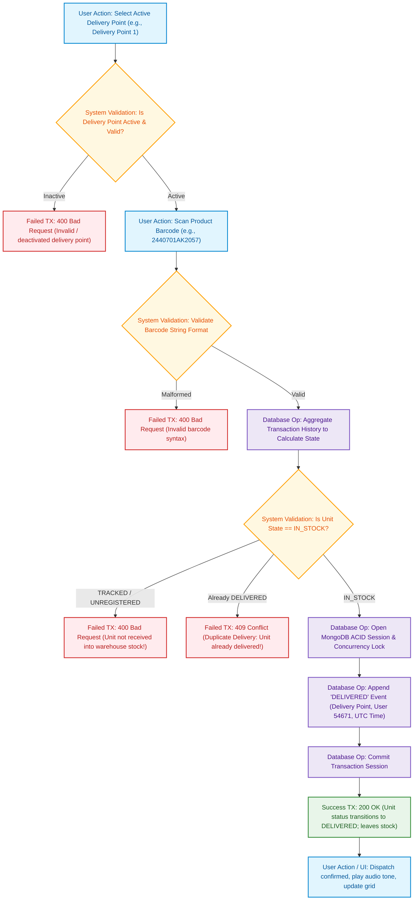

# 04. Product Delivery Flow Diagram
## Responsible Role: `DELIVERY_USER` or `ADMIN`

### 1. Operational Overview
Product delivery dispatches stock from warehouse inventory to shipping docks:
1. Operator navigates to Delivery Station (`/operations/delivery`).
2. Operator selects an active Delivery Point (e.g., `Refrigerator Delivery Point 1`).
3. Operator scans the Product Barcode (e.g., `2440701AK2057`).
4. System calculates the product's current stock state dynamically:
   - Evaluates whether unit is currently `IN_STOCK` (Rule BR-06).
   - If unit is `UNREGISTERED` or `TRACKED`, delivery is blocked (`400 Bad Request`).
   - If unit is already `DELIVERED`, double dispatch is blocked (`409 Conflict`).
5. System opens a MongoDB ACID session with concurrency write lock.
6. System appends an immutable `DELIVERED` event document into `inventory_transactions` (recording Delivery Point, user ID `54671`, and timestamp).
7. Stock count decrements from available warehouse inventory.
8. Status dynamically updates to `DELIVERED`, and visual/audio confirmation is presented.

---

### 2. Mermaid Flowchart

