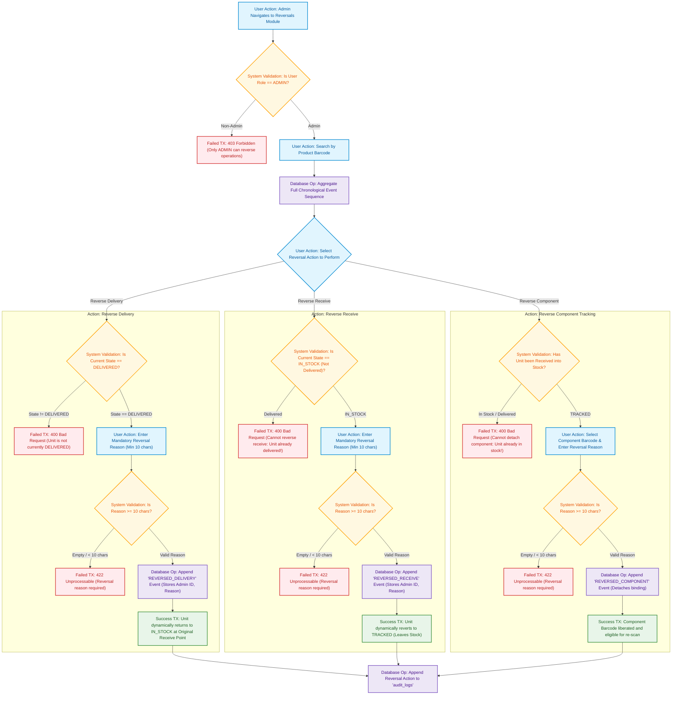

# 05. Reversal & Correction Flow Diagram
## Responsible Role: `ADMIN` Exclusively

### 1. Operational Overview
The reversal engine provides audit-compliant operational remediation:
1. Admin logs into Reversals Portal (`/operations/reversals`).
2. Admin enters/scans the target Product Barcode.
3. System loads the complete chronological event stream from `inventory_transactions`.
4. Admin chooses which operation to reverse:
   - **Reverse Delivery:** Allowed only if current state is `DELIVERED`. Unit dynamically returns to `IN_STOCK` at its **original Receive Point**.
   - **Reverse Receive:** Allowed only if current state is `IN_STOCK`. Blocked if downstream `DELIVERED` event exists (Rule BR-14). Unit reverts to `TRACKED` state.
   - **Reverse Component Tracking:** Allowed only if product has not yet been received. Detaches component barcode, liberating it for reuse (Rule BR-16).
5. Admin submits a **mandatory textual reason** (min 10 characters). If omitted, transaction is blocked.
6. System appends a compensating event (`REVERSED_*`) without deleting or updating past events.
7. System logs the administrative intervention to `audit_logs`.
8. UI updates to reflect recalculated product state and timeline.

---

### 2. Mermaid Flowchart

