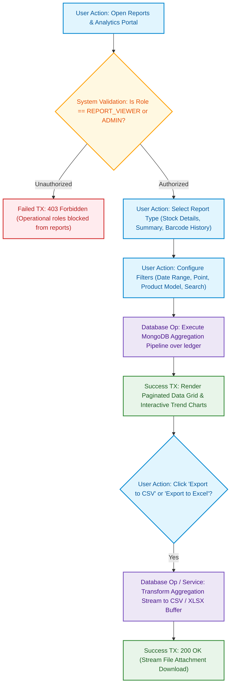

# 06. Reporting, Analytics & Data Export Flow Diagram
## Responsible Role: `REPORT_VIEWER` or `ADMIN`

### 1. Operational Overview
The reporting engine leverages dynamic aggregation pipelines directly over the append-only ledger:
1. User navigates to Reports Portal (`/reports/*`).
2. Express RBAC middleware validates user role. Only `REPORT_VIEWER` and `ADMIN` are authorized. Operational roles are blocked with `403 Forbidden`.
3. User selects the report module:
   - **Stock Details Report:** Shows every unit currently in stock, its physical Receive Point, entry timestamp, days in warehouse, and linked serialized components.
   - **Date-Range Summary & Daily Graph:** Aggregates total units received, delivered, and reversed between two dates; plots interactive trend lines.
   - **Barcode Lifecycle Journey:** Visualizes complete timeline for any specific chassis serial from component tracking through receiving, delivery, and any reversals.
4. User applies search filters (Barcode, Product, Point, Date Range).
5. MongoDB aggregation pipeline executes with compound index acceleration.
6. Frontend renders paginated table and charts.
7. User triggers CSV or Excel export (`.xlsx`), streamed directly as a downloaded attachment.

---

### 2. Mermaid Flowchart

