# 07. Comprehensive Exception Handling Matrix & Resolution Flow
## System-Wide Error Interception & Recovery Architecture

### 1. Operational Overview
The system employs multi-layered exception handling across client-side validation, server route schemas, business rule validators, and database transactions.

All 13 operational exception scenarios specified in the assignment are handled deterministically:
1. **Invalid Product Barcode:** Malformed syntax rejected with `400 Bad Request`.
2. **Invalid Component Barcode:** Malformed syntax rejected with `400 Bad Request`.
3. **Duplicate Component Scan:** Component barcode already active on another chassis rejected with `409 Conflict`.
4. **Duplicate Product Scan:** Double receive attempt rejected with `409 Conflict` (Duplicate Scan Warning).
5. **Product Not Yet Tracked:** Receiving untracked chassis rejected with `422 Unprocessable Entity`.
6. **Product Already Received:** Component tracking attempted after receiving rejected with `422 Unprocessable Entity`.
7. **Product Already Delivered:** Delivery attempted on already delivered chassis rejected with `409 Conflict`.
8. **Product Not Available in Stock:** Delivery attempted on untracked or unreceived unit rejected with `400 Bad Request`.
9. **Unauthorized Operation:** Non-authorized role attempting privileged action rejected with `403 Forbidden`.
10. **Invalid Receive Point:** Non-existent or deactivated receive point rejected with `400 Bad Request`.
11. **Invalid Delivery Point:** Non-existent or deactivated delivery point rejected with `400 Bad Request`.
12. **Invalid Reversal:** Reversing receive on an already delivered unit rejected with `400 Bad Request`.
13. **Missing Reversal Reason:** Omitted or short (< 10 chars) reversal reason rejected with `422 Unprocessable Entity`.

---

### 2. Mermaid Flowchart

```mermaid
flowchart TD
    %% Styling Definitions
    classDef userAction fill:#E1F5FE,stroke:#0288D1,stroke-width:2px,color:#01579B;
    classDef validation fill:#FFF8E1,stroke:#FFA000,stroke-width:2px,color:#E65100;
    classDef dbOp fill:#EDE7F6,stroke:#7E57C2,stroke-width:2px,color:#4A148C;
    classDef successTx fill:#E8F5E9,stroke:#388E3C,stroke-width:2px,color:#1B5E20;
    classDef failedTx fill:#FFEBEE,stroke:#D32F2F,stroke-width:2px,color:#B71C1C;

    subgraph InputValidation["Stage 1: Input Syntax & RBAC Gates"]
        V_Role{"1. RBAC Gate: User Role Permitted?"}:::validation
        E_Role["Failed TX: 403 Forbidden (Unauthorized Operation)"]:::failedTx

        V_PFormat{"2. Product Barcode Syntax Valid?"}:::validation
        E_PFormat["Failed TX: 400 Bad Request (Invalid Product Barcode)"]:::failedTx

        V_CFormat{"3. Component Barcode Syntax Valid?"}:::validation
        E_CFormat["Failed TX: 400 Bad Request (Invalid Component Barcode)"]:::failedTx

        V_PtValid{"4. Physical Point Active & Valid?"}:::validation
        E_PtValid["Failed TX: 400 Bad Request (Invalid Receive / Delivery Point)"]:::failedTx
    end

    subgraph StateGates["Stage 2: Dynamic Lifecycle State Invariants"]
        V_CompExcl{"5. Component Barcode Already Bound?"}:::validation
        E_CompExcl["Failed TX: 409 Conflict (Duplicate Component Scan)"]:::failedTx

        V_TrackedGate{"6. Has Unit Undergone Component Tracking?"}:::validation
        E_Untracked["Failed TX: 422 Unprocessable (Product Not Yet Tracked)"]:::failedTx

        V_PostRec{"7. Is Component Tracking Attempted After Receive?"}:::validation
        E_PostRec["Failed TX: 422 Unprocessable (Product Already Received)"]:::failedTx

        V_DblRec{"8. Is Unit Already IN_STOCK at Warehouse?"}:::validation
        E_DblRec["Failed TX: 409 Conflict (Duplicate Product Scan / Already Received)"]:::failedTx

        V_StockAvail{"9. Is Unit Available IN_STOCK for Delivery?"}:::validation
        E_NoStock["Failed TX: 400 Bad Request (Product Not Available in Stock)"]:::failedTx

        V_DblDel{"10. Has Unit Already Been Delivered?"}:::validation
        E_DblDel["Failed TX: 409 Conflict (Product Already Delivered)"]:::failedTx
    end

    subgraph ReversalGates["Stage 3: Administrative Reversal Invariants"]
        V_RevElig{"11. Is Target Event Eligible for Reversal?"}:::validation
        E_RevElig["Failed TX: 400 Bad Request (Invalid Reversal: Downstream Delivered)"]:::failedTx

        V_RevReason{"12. Is Reversal Reason Provided (>= 10 chars)?"}:::validation
        E_RevReason["Failed TX: 422 Unprocessable (Missing Reversal Reason)"]:::failedTx
    end

    subgraph GlobalHandler["Stage 4: Centralized Error Handler & UI Feedback"]
        GH["Centralized Express Error Handler & Logger"]:::dbOp
        UI_Toast["Client Feedback: Visual Red Toast + Audio Error Buzzer + Input Reset"]:::failedTx
    end

    %% Connections
    V_Role -- "Unauthorized" --> E_Role
    V_PFormat -- "Malformed" --> E_PFormat
    V_CFormat -- "Malformed" --> E_CFormat
    V_PtValid -- "Inactive / Missing" --> E_PtValid

    V_CompExcl -- "Bound" --> E_CompExcl
    V_TrackedGate -- "Untracked" --> E_Untracked
    V_PostRec -- "Already in stock" --> E_PostRec
    V_DblRec -- "Double Receive" --> E_DblRec
    V_StockAvail -- "Not in stock" --> E_NoStock
    V_DblDel -- "Delivered" --> E_DblDel

    V_RevElig -- "Delivered check fails" --> E_RevElig
    V_RevReason -- "Empty / Short" --> E_RevReason

    %% All Errors funnel to Global Handler
    E_Role --> GH
    E_PFormat --> GH
    E_CFormat --> GH
    E_PtValid --> GH
    E_CompExcl --> GH
    E_Untracked --> GH
    E_PostRec --> GH
    E_DblRec --> GH
    E_NoStock --> GH
    E_DblDel --> GH
    E_RevElig --> GH
    E_RevReason --> GH

    GH --> UI_Toast
```

